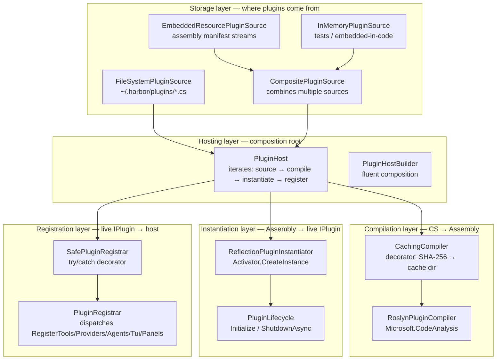

# Harbor Plugin System — Roslyn CS-source plugins

> How to write, install, and debug plugins for Harbor using **CS-source files** compiled
> at runtime via Roslyn. No DLLs, no `.csproj`, no separate build step.

## TL;DR

1. Drop a `.cs` file into `~/.harbor/plugins/` (user-global) or `<project>/.harbor/plugins/`
   (project-local).
2. The file must contain at least one public class implementing `IPlugin` (or one of its
   sub-interfaces: `IToolPlugin`, `IProviderPlugin`, `IAgentPlugin`) with a parameterless
   constructor.
3. Start Harbor — `harbor-plugins-host` (registered automatically as the
   `harbor-csharp-plugins` MCP server when it ships next to the CLI)
   compiles the file and serves its tools over MCP. The CLI process itself
   never compiles plugins (#1055).
4. Compilation errors are reported by the host and surface through MCP as
   `isError` tool results; the CLI logs which plugin route it took at startup.
5. Compiled assemblies are cached by source SHA-256 in `~/.harbor/plugins/cache/`.

## Architecture (layered runtime)

The plugin runtime is split across dedicated `Harbor.Plugins.*` projects
(`src/Harbor.Plugins.{Storage,Compilation,Instantiation,Registration,Hosting}`,
with shared contracts in `Harbor.Plugins.Abstractions` and the legacy
`CsPluginLoader` facade kept in `src/Harbor.Plugins.Runtime/`). Each layer depends
only on the previous layer's **interface**, never its implementation. This separation
lets you swap storage backends (filesystem, embedded resources, network, git),
compilation engines (Roslyn, scripted, pre-built DLL), and instantiation strategies
(reflection, DI-aware, interpreter) independently.



| Layer | Project | Interface | Default impl | What it does |
|---|---|---|---|---|
| Storage | `Harbor.Plugins.Storage` | `IPluginSource` | `FileSystemPluginSource` | Async-streams `PluginScript` values from disk / embedded / in-memory. |
| Compilation | `Harbor.Plugins.Compilation` | `IPluginCompiler` | `CachingCompiler` over `RoslynPluginCompiler` | Compiles a `PluginScript` into a loaded `CompiledPluginAssembly`. Caches by SHA-256. |
| Instantiation | `Harbor.Plugins.Instantiation` | `IPluginInstantiator` | `ReflectionPluginInstantiator` | Finds `IPlugin` impls in the assembly, `Activator.CreateInstance`, returns `LoadedPlugin`. Does NOT call `Initialize`. |
| Registration | `Harbor.Plugins.Registration` | `IPluginRegistrar` | `SafePluginRegistrar` over `PluginRegistrar` | Builds `PluginContext`, calls `IPlugin.Initialize`, dispatches `RegisterTools` / `RegisterProviders` / `RegisterAgents` / `RegisterTuiPlugin` / `RegisterPanels`. |
| Hosting | `Harbor.Plugins.Hosting` | (no interface — `PluginHost` is the facade) | `PluginHost` + `PluginHostBuilder` | Iterates `source → compile → instantiate → register`. Logs per-plugin failures; honors `ContinueOnError`. |

Shared contracts (`IPluginSource`, `IPluginCompiler`, `IPluginInstantiator`,
`IPluginRegistrar`, `IPluginLoadHost`, `PluginScript`, `CompiledPluginAssembly`,
`LoadedPlugin`) live in `src/Harbor.Plugins.Abstractions/`.

### Why the split

Before v0.4.x, a single `CsPluginLoader` class (~570 lines) did all seven
responsibilities: discovery, hashing, caching, Roslyn compilation, reflection
instantiation, initialization, and registration. This violated SRP and prevented:

- Testing compilation without the filesystem.
- Using alternative storage (embedded resources, network, git).
- Adding other engines (e.g. a SharpTS scripted evaluator) without duplicating storage logic.

Each layer is now independently testable and swappable.

### Swapping each layer

**Custom storage** — read from a network source:

```csharp
public sealed class NetworkPluginSource : IPluginSource
{
    private readonly Uri _endpoint;
    public NetworkPluginSource(Uri endpoint) { _endpoint = endpoint; }

    public async IAsyncEnumerable<PluginScript> GetScriptsAsync(
        [EnumeratorCancellation] CancellationToken ct = default)
    {
        using var http = new HttpClient();
        var listing = await http.GetFromJsonAsync<List<string>>($"{_endpoint}/plugins", ct);
        foreach (var name in listing ?? Array.Empty<string>())
        {
            var source = await http.GetStringAsync($"{_endpoint}/plugins/{name}", ct);
            yield return new PluginScript(name, source);
        }
    }
}

var host = new PluginHostBuilder()
    .WithSource(new NetworkPluginSource(new Uri("https://plugins.example.com")))
    .WithCompiler(...)
    .WithInstantiator(...)
    .WithRegistrar(...)
    .Build();
```

**Custom compilation** — pre-built DLLs (no Roslyn):

```csharp
public sealed class PreBuiltDllCompiler : IPluginCompiler
{
    public Task<Result<CompiledPluginAssembly>> CompileAsync(PluginScript script, CancellationToken ct = default)
    {
        // script.Path is a .dll path; load via Assembly.LoadFrom
        var asm = Assembly.LoadFrom(script.Path);
        return Task.FromResult(Result.Success(
            new CompiledPluginAssembly(asm, script.Hash, script.Path)));
    }
}
```

**Custom instantiation** — DI-aware activator:

```csharp
public sealed class DiInstantiator : IPluginInstantiator
{
    private readonly IServiceProvider _sp;
    public DiInstantiator(IServiceProvider sp) { _sp = sp; }

    public Result<IReadOnlyList<LoadedPlugin>> Instantiate(CompiledPluginAssembly compiled)
    {
        // ... find IPlugin types, resolve via _sp.GetService(type) ...
    }
}
```

### Composing the runtime in the host

```csharp
var pluginHost = new PluginHostBuilder()
    .WithSource(new FileSystemPluginSource(
        new[] { globalPluginsDir, projectPluginsDir },
        loggerFactory.CreateLogger<FileSystemPluginSource>()))
    .WithCompiler(new CachingCompiler(
        new RoslynPluginCompiler(pluginReferences),
        pluginsCacheDir,
        loggerFactory.CreateLogger<CachingCompiler>()))
    .WithInstantiator(new ReflectionPluginInstantiator())
    .WithRegistrar(new SafePluginRegistrar(
        new PluginRegistrar(globalPluginsDir, loggerFactory.CreateLogger<PluginRegistrar>(), loggerFactory),
        loggerFactory.CreateLogger<SafePluginRegistrar>()))
    .WithOptions(o => o.PluginRoot = globalPluginsDir)
    .Build(loggerFactory.CreateLogger<PluginHost>());

await pluginHost.LoadAllAsync(loadHost, ct);
```

## Where plugins live

| Location | Scope | Use case |
|---|---|---|
| `~/.harbor/plugins/*.cs` | User-global, all Harbor invocations | Personal plugins — `websearch`, `git-tools`, custom tools you use everywhere. |
| `<project>/.harbor/plugins/*.cs` | Project-local, only when running Harbor from `<project>` | Project-specific tools — e.g. a `release-notes` tool that only makes sense in one repo. |

Both directories are scanned on every Harbor startup. Files in either directory are
compiled into separate in-memory assemblies — they do NOT share types or namespaces.

## Managing plugins from the agent (#1738)

Harbor had no agent-facing plugin management until #1738: `harbor plugin
list|install|uninstall` is a CLI verb, and the `/plugins` panel is a UI surface.
The agent could neither see what was installed nor propose a change.

The `plugin_manager` tool closes that gap, and it is the first Harbor tool whose
safety is provided by POLICY rather than by trust:

- **It reads the inventory.** `action: "list"` reports every installed plugin
  in both scopes, with the facts the plugin declares in its manifest (version,
  extension axes, the Harbor floor it needs) — read as DATA, without compiling
  the plugin.
- **It proposes a change.** `install`, `uninstall`, `enable` and `disable` build
  a concrete proposal: which file, which scope, what will happen to it.
- **The change happens only after the user approves it.** The tool asks through
  the same approval channel the permission service uses (`ToolContext.Ask`),
  and a denial, a cancellation or an unavailable approval channel ends the call
  with nothing changed. The tool fails closed, exactly like the permission
  service does.
- **An approval covers that one call.** The answer is never written back to a
  ruleset, so the session's permission mode is unchanged by it. A user who does
  not want an agent touching plugins writes `new("plugin_manager", "*", Deny)`
  in their config and the tool never starts; the read-only agents deny it
  outright.
- **Everything is logged.** The proposal, the answer and the outcome are three
  separate log lines, so "the agent tried to install a plugin" is a fact in the
  log and not a fact in the transcript.

**One inventory, two consumers.** The tool and the `/plugins` panel read the
SAME `IPluginInventory` — one implementation, so the panel and the agent cannot
disagree about what is installed. The port lives in the Domain
(`Harbor.Abstractions.Plugins.IPluginInventory`) because the tool
(`Harbor.Tools.Builtin`) may not bind the plugin layers; the implementation
lives in `Harbor.Plugins.Storage`, the layer that knows where plugin files come
from.

**What "install" means.** CS plugins are served by the separate
`harbor-plugins-host` process, so installing a plugin means copying a reviewed
`.cs` file (and the manifest it ships next to it) into a plugin scope. The host
picks it up on its next start; nothing is compiled or registered in the CLI
process. `enable` / `disable` rename the file to and from `<Name>.cs.disabled`,
which is the switch the loader's `*.cs` glob reads.

## What APIs are available

The compiled plugin can reference any type already loaded in the host's AppDomain at
startup. This always includes:

| Namespace | Package | What's there |
|---|---|---|
| `Harbor.Abstractions` | `Harbor.Abstractions.dll` | All Harbor contracts: `IPlugin`, `ITool`, `ILlmClient`, `IAgent`, models, events. |
| `Harbor.Abstractions.Tools` | `Harbor.Abstractions.dll` | `ITool`, `IToolRegistryBuilder`, `ToolResult`, `ToolContext`. |
| `Harbor.Abstractions.Plugins` | `Harbor.Abstractions.dll` | `IPlugin`, `IToolPlugin`, `IProviderPlugin`, `IAgentPlugin`, `PluginContext`. |
| `Harbor.Abstractions.Models` | `Harbor.Abstractions.dll` | `ToolResult`, `AgentMessage`, `UserMessage`, `AssistantMessage`, etc. |
| `Harbor.Abstractions.Models.Identifiers` | `Harbor.Abstractions.dll` | `ToolName`, `ProviderId`, `AgentName`, `SessionId`, etc. |
| `Harbor.Abstractions.Events` | `Harbor.Abstractions.dll` | `AgentEvent` and all event sub-types, `IEventBus`. |
| `Harbor.Terminal.Abstractions.Plugins` | `Harbor.Terminal.Abstractions.dll` | `ITuiPlugin` — closed seam (#564): collected, never rendered. Use `ITuiPanelPlugin`. |
| `System.Text.Json` | BCL | `JsonDocument`, `JsonElement` for tool schemas and arguments. |
| `CSharpFunctionalExtensions` | NuGet | `Result`, `Result<T>` for error handling. |
| `Microsoft.Extensions.Logging` | NuGet | `LogInformation`, `LogError`, etc. extension methods. |
| `System.Net.Http` | BCL | `HttpClient` for HTTP-based tools. |
| `System.Text.RegularExpressions` | BCL | `Regex` for parsing. |

If you need a type that's NOT yet loaded in the host (e.g. a third-party NuGet you
depend on), the plugin will fail to compile with `CS0246: type or namespace not found`.
To fix this, either:
- Reference the package from a regular Harbor assembly so it's loaded at startup, OR
- Use the DLL-based plugin path (see [PLUGIN_DEVELOPMENT.md](./PLUGIN_DEVELOPMENT.md)).

## Plugin contract

```csharp
public interface IPlugin
{
    string Name { get; }                  // stable lowercase id, e.g. "web-search"
    Version Version { get; }              // semantic version
    Version RequiredHarborVersion { get; } // minimum Harbor version
    string Description { get; }           // shown in /plugins

    IReadOnlyList<string> Dependencies => []; // what the plugin needs before it activates (#1733)

    void Initialize(PluginContext context);            // called once on load
    Task ShutdownAsync(CancellationToken ct = default); // called once on unload
}

// Pick one or more of these sub-interfaces:
public interface IToolPlugin : IPlugin
{
    void RegisterTools(IToolRegistryBuilder builder);
}

public interface IProviderPlugin : IPlugin
{
    void RegisterProviders(IProviderRegistryBuilder builder);
}

public interface IAgentPlugin : IPlugin
{
    void RegisterAgents(IAgentRegistryBuilder builder);
}
```

For TUI extensions:

> **`ITuiPlugin` is a closed seam (#564).** It loads, and nothing ever calls
> `RegisterTui` — the host door has stored nothing since #916, when its unread
> `TuiPlugins` list was deleted — so a plugin view is collected and never
> rendered. It does not extend `IPlugin`, and
> the loader does detect each interface independently; the closure is about the
> *consumer*, not the discovery. Implement `ITuiPanelPlugin` for a panel that is
> painted. Guarded by `tests/Harbor.Architecture.Tests/CellForgeWidgetAxisRules.cs`.

```csharp
public interface ITuiPlugin
{
    string Name { get; }
    Version Version { get; }
    string Description { get; }

    void RegisterTui(ViewRegistry views, ViewModelRegistry viewModels); // never called
}
```

For a TUI panel — the live axis:

```csharp
public interface ITuiPanelPlugin : IPlugin
{
    void RegisterPanels(IPanelRegistry registry);
}
```

## Version compatibility (#1721)

`RequiredHarborVersion` is a **minimum**, and it is enforced. The registration
layer checks it in front of `IPlugin.Initialize`, so an incompatible plugin
contributes nothing to the host: no tool, no provider, no agent, no panel, and
no half-initialized state left behind.

| Running Harbor | Declared `RequiredHarborVersion` | Result |
|---|---|---|
| 0.4.0 | 0.4.0 | loads, because the boundary is inclusive |
| 0.4.0 | 0.2.0 | loads, because the declaration is a floor and the runtime is above it |
| 1.0.0 | 0.4.0 | loads, because a Harbor newer than the plugin asks for still satisfies it |
| 0.4.0 | 0.6.0 | refused. The plugin is not initialized and does not load |
| 0.4.0 | not declared | loads. There is no floor to enforce, and the host logs the missing declaration |

The refusal names the plugin, the Harbor version it needs and the Harbor version
that is running:

> `Plugin 'web-search' requires Harbor >= 0.6.0, but this Harbor is 0.4.0. The plugin was not loaded.`

Versions are compared component-wise with an unspecified component read as 0, so
`0.4` and `0.4.0` name the same Harbor. A plugin may declare major and minor only.

Where the refusal lands: the registrar returns a failed `Result`, and the load
path logs it. Under `ContinueOnError=false` (the single-plugin API) the whole
load fails with that reason. Under the default `ContinueOnError=true` the
incompatible plugin is skipped and the other plugins still load. Either way the
plugin does not appear in the loaded-plugins list, because it did not load.

The gate lives in `src/Harbor.Plugins.Abstractions/PluginCompatibility.cs` and is
called from `PluginRegistrar.Register`, the one seam both load routes pass
through: the out-of-process `harbor-plugins-host` and the legacy in-process
`CsPluginLoader`.

## Declared dependencies and deferred activation (#1733)

A plugin can declare what it needs before the host activates it:

```csharp
public IReadOnlyList<string> Dependencies => new[] { "mcp-session" };
```

The names are opaque strings and the HOST decides what a name means and when it
becomes true. Two kinds of name resolve today:

| The name | Resolved against | Satisfied when |
|---|---|---|
| another plugin's `Name` | the plugins in the same load set | that plugin is ACTIVE |
| a capability the host published | `IPluginDependencyResolver` | the host's probe says so |

The out-of-process host publishes one capability: `mcp-session` — the MCP
session with the CLI. It is false while the plugins load (the client has not
connected yet) and true from the handshake onwards.

**What "not ready" means.** The plugin is LOADED — compiled, instantiated, known
to the host — but NOT ACTIVATED: `Initialize` has not run and no `Register*`
call has happened, so it contributes no tool, no provider, no agent, no panel.
It is listed in `PluginHost.PendingPlugins` with the names it waits for, and the
host logs it:

> Plugin web-search@1.0.0 (WebSearchPlugin.cs) is registered but not activated: waiting for mcp-session.

**What the user sees.** The host's log (the line above) and the host's
inventory (`PluginHost.PendingPlugins`). The CLI's `/plugins` panel lists the
plugin FILES, not their activation state — the activation state lives in the
host process, which is where the plugins run.

**When it activates.** The host re-checks the pending plugins on every
activation pass: once at the end of the load (so a plugin that depends on
another plugin loaded in the same pass comes up with it), and whenever the
composition root says the environment changed — for the out-of-process host,
that is the MCP handshake. The plugin is then initialized and registered like
any other.

**The version gate still applies, at activation time.** A plugin that needs a
Harbor newer than the running one is refused by the registrar in front of
`Initialize` (§Version compatibility), and nothing changes about that refusal:
no tool, no provider, no half-initialized state. A plugin that is still waiting
for a dependency has not been version-checked yet — the check runs when the
dependency is met, and the refusal is the same refusal it was before.

**A name the host does not know is never satisfied.** Unknown is not ready: a
capability the host never published must not read as "available", or the plugin
would activate against an infrastructure that is not there and fail at the
moment it matters.

**A cycle does not hang the load.** Two plugins that require each other can
never both activate. The activation pass is a loop over a snapshot, never a
recursion, so it terminates, and the cycle is reported rather than waited on
silently:

> Plugin a@1.0.0 is blocked by a circular dependency (a -> b -> a). It will not activate until the cycle is broken.

## The plugin manifest (#1739)

A plugin may ship a **manifest**: a JSON document that says what the plugin
declares about itself, next to its code. The manifest is DATA. The host reads
it without compiling the plugin, without loading its assembly and without
running a line of its code.

The file lives next to the source and is named after it:

| Plugin source | Manifest |
|---|---|
| `~/.harbor/plugins/MyPlugin.cs` | `~/.harbor/plugins/MyPlugin.harbor-plugin.json` |
| `<project>/.harbor/plugins/tools/MyPlugin.cs` | `<project>/.harbor/plugins/tools/MyPlugin.harbor-plugin.json` |

One manifest, one plugin. A directory may hold several plugins, and each of
them has its own manifest, so two plugins in one directory never share one
declaration of name and version.

A minimal manifest:

```json
{
  "name": "web-search",
  "version": "1.2.0",
  "harbor": "0.4.0",
  "capabilities": ["http_requests"],
  "axes": ["IToolPlugin"]
}
```

### What each field means

| Field | Meaning |
|---|---|
| `schemaVersion` | The manifest format. Absent means 1. A manifest that asks for a format this Harbor does not implement is refused, not guessed at. |
| `name` | The plugin's id. Optional. When present it must equal `IPlugin.Name`. |
| `version` | The plugin's own version. Optional. When present it must equal `IPlugin.Version`. |
| `harbor` | The minimum Harbor version the plugin needs — the same floor `IPlugin.RequiredHarborVersion` declares, checked by the same gate. |
| `capabilities` | The capabilities the plugin asks for. Optional. When present it REPLACES the `// harbor:capabilities` directive. |
| `axes` | The extension axes the plugin contributes, named as `PluginAxisRegistry` names them (`IToolPlugin`, `IProviderPlugin`, …). Optional. When present it must equal the axes the plugin implements. |

Every field is optional. A manifest that declares nothing is a valid manifest,
and a plugin with no manifest at all is a plugin the host knows nothing extra
about: it loads exactly as it did before the manifest existed.

### Who reads it, and when

**The host reads it at discovery, before the plugin is compiled.** A manifest
that asks for a Harbor newer than the running one is refused there, so an
incompatible plugin costs a JSON read instead of a Roslyn compile. The refusal
is the same one the in-code floor gets:

> Plugin 'web-search' requires Harbor >= 0.6.0, but this Harbor is 0.4.0. The plugin was not loaded.

**The registrar reads it again at registration**, where the code is loaded and
the declaration can be checked against it. A manifest that names the plugin
differently, declares a different version, or declares axes the plugin does not
implement is refused, and the refusal names both sides:

> The manifest of plugin 'web-search' declares the extension axes [IToolPlugin], but the plugin implements [IToolPlugin, IAgentPlugin]. The manifest and the plugin must agree, or the manifest must not declare axes.

The code stays the truth for what the plugin DOES. The manifest says what it
CLAIMS, and a claim that does not match the code is refused: a plugin that
ships two versions of itself is a plugin the host cannot describe.

### The rules the read follows

| Situation | What happens |
|---|---|
| A field this build does not know | Ignored, and reported in the log. A manifest written for a newer Harbor still loads here. |
| A capability name the host does not know | The manifest is refused. The same strict reading the comment directive gets. |
| An extension axis the host does not have | The manifest is refused, and the message names the axes that exist. |
| A version that is not a version | The manifest is refused, and the message says what a version looks like. |
| A schema version this build does not implement | The manifest is refused. |
| A manifest that cannot be parsed at all | The plugin is not loaded, with the reason. |

A manifest that cannot be read is a REFUSAL of the plugin, not a fallback to
the no-manifest behaviour. The plugin shipped a declaration and the host
failed to apply it, and loading it anyway would mean running a plugin whose own
constraints were dropped.

### Capabilities: the manifest replaces the directive

The comment directive stays, and it stays the fallback:

```csharp
// harbor:capabilities read_files,http_requests
```

| Plugin ships | The declared capability set is |
|---|---|
| No manifest | The directive, exactly as before. |
| A manifest without `capabilities` | The directive, exactly as before. |
| A manifest with `capabilities` | The manifest's list. The directive is not read at all. |

The manifest's list is the plugin's CEILING, not a request: the trust gate
narrows it to what the user approved, and the sandbox enforces the approved
subset. A manifest that declares `"capabilities": []` is a plugin that asks for
nothing.

### The manifest is part of the plugin's content

The content hash of a plugin covers its source AND its manifest, so:

- editing the manifest invalidates the compiled-assembly cache entry (the
  plugin is rebuilt);
- editing the manifest invalidates the persisted trust decision, so the user is
  asked again. A trust decision given for a different declaration is not a
  decision about this plugin.

A plugin with no manifest hashes exactly as it did before, so existing caches
and trust decisions keep working.

### What the manifest does NOT carry

**The dependencies.** They live on `IPlugin.Dependencies` (§Declared
dependencies) and they are a runtime concern: the host resolves a dependency
name against what is loaded and what it publishes, so a name in a file would be
a second spelling of a name the host owns.

## The plugin inventory (#1722)

Three questions have three answers in three shapes, and a program cannot ask
any of them:

- "did my plugin compile?" — a line in the host log;
- "did it register?" — another line, and sometimes a refusal reason;
- "is its tool visible to the agent?" — a third line, or nothing at all.

The **plugin inventory** is one document that answers all three. It is a
projection: the host keeps the ledger as the load proceeds and renders it, so
the inventory cannot disagree with the host about a plugin's phase.

### What it says

| Member | Meaning |
|---|---|
| `schemaVersion` | The format version. A consumer that does not know it reads a document it cannot trust. |
| `route` | The route this composition is on, or `null` when the host was not told. |
| `axes` | The extension axes the product declares, read from `PluginAxisRegistry`. |
| `routes` | What each route does with each axis, and why, read from `PluginRouteAxisRegistry`. |
| `plugins` | The plugins, in the order the host met them. |

A plugin entry carries its `name`, its `version`, its `source`, its `phase`
(`pending`, `active` or `failed`), the `axes` it carries, the `dependencies` it
declared and the ones that are not satisfied yet, whether it ships a
`manifest`, what each of its `registrations` did in the host, and the
`failureReason` when the host refused it.

### Where to read it

**Live, over MCP.** The plugin host answers the namespaced method
`harbor/plugins/inventory` with the document, rendered at the moment it is
asked. It is read-only: it changes nothing.

```bash
# any MCP client that speaks to harbor-csharp-plugins
{"jsonrpc":"2.0","id":1,"method":"harbor/plugins/inventory"}
```

**From the CLI.** The host also writes the same document into its plugin root
(`~/.harbor/plugins/inventory.json`) and rewrites it whenever the composition
changes — after the load, and after every activation pass. `harbor plugin
inventory` prints it:

```bash
harbor plugin inventory
```

A file is a snapshot of the last load, not a live channel: the MCP method is
the live one. The file exists because `harbor plugin inventory` is a host-free
verb with no MCP session to ask through.

**The tree's own composition** is committed, in the same schema:
[`docs/PLUGIN_INVENTORY.json`](./PLUGIN_INVENTORY.json) says what the
repository declares — the axes, the per-route verdicts, and the plugins the
samples ship. `tools/gen-plugin-inventory.py --check` fails when that
document no longer matches the tree, and when the two producers disagree about
the schema.

### What the snapshot does NOT say

The tree's document says `phase: declared` for every plugin: a plugin in the
repository is not loaded, so there is no phase to report. The live phases
belong to the runtime document.

## Minimal example — a hello tool

Drop this into `~/.harbor/plugins/HelloWorldPlugin.cs`:

```csharp
using System.Text.Json;
using CSharpFunctionalExtensions;
using Harbor.Abstractions.Models;
using Harbor.Abstractions.Models.Identifiers;
using Harbor.Abstractions.Plugins;
using Harbor.Abstractions.Tools;
using Microsoft.Extensions.Logging;

public sealed class HelloWorldPlugin : IToolPlugin
{
    public string Name => "hello-world";
    public Version Version => new(1, 0, 0);
    public Version RequiredHarborVersion => new(0, 4, 0);
    public string Description => "Adds a `hello` tool that returns a greeting.";

    public void Initialize(PluginContext context)
    {
        context.CreateLogger<HelloWorldPlugin>().LogInformation("HelloWorld initialized");
    }

    public void RegisterTools(IToolRegistryBuilder builder) => builder.AddTool<HelloTool>();

    public Task ShutdownAsync(CancellationToken ct = default) => Task.CompletedTask;
}

public sealed class HelloTool : ITool
{
    public ToolName Name => ToolName.Create("hello");
    public string DisplayName => "Hello";
    public string Description => "Returns a friendly greeting";
    public JsonDocument ParameterSchema => JsonDocument.Parse(
        "{\"type\":\"object\",\"properties\":{\"name\":{\"type\":\"string\"}}}");
    public ExecutionMode ExecutionMode => ExecutionMode.Parallel;
    public string? PromptSnippet => "hello: returns a greeting";
    public IReadOnlyList<string> PromptGuidelines => Array.Empty<string>();

    public Task<ToolResult> ExecuteAsync(
        JsonElement args, ToolContext context, CancellationToken ct = default)
    {
        string name = args.TryGetProperty("name", out var n) && n.ValueKind == JsonValueKind.String
            ? n.GetString() ?? "world"
            : "world";
        return Task.FromResult(ToolResult.Success($"Hello, {name}!"));
    }
}
```

Run `harbor` and ask the agent: "Use the hello tool with name=Harbor". The agent will
call the freshly-compiled `hello` tool and report the result.

See `samples/plugins-cs/HelloWorldPlugin.cs` for the same example as a file.

## Lifecycle (default: out-of-process since #1055)

The CLI process itself never compiles plugins. By default CS-source plugins are
served out-of-process by `harbor-plugins-host` (registered automatically as the
`harbor-csharp-plugins` MCP server when it ships next to the CLI); the CLI lists
and calls plugin tools over MCP stdio. The Storage → Compilation →
Instantiation → Registration → Hosting pipeline below runs **inside the host
process**; only the tool capability crosses the wire.

**What the route does with each axis is declared once**, in
`src/Harbor.Plugins.Hosting/PluginRouteAxisRegistry.cs`: every axis of
extension (`src/Harbor.Plugins.Abstractions/PluginAxisRegistry.cs`) has a row
there saying whether the out-of-process route CARRIES it, REFUSES it (with the
technical reason it cannot cross the process boundary), or whether the axis is
a CLOSED SEAM everywhere (#564). The refusal messages the host answers with are
built from that declaration, so the reason a plugin author reads is the reason
the product declares. The architecture gate
(`tests/Harbor.Architecture.Tests/ExtensionAxisRouteCarriageRule.cs`) grades
the declaration against the code: an axis with no declared fate fails, and so
does a door that does not do what its row says.

```
1. Harbor starts; the CLI probes for the plugin host (startup log says which
   plugin route it took)
2. The host's PluginHost.LoadAllAsync() iterates the configured IPluginSource:
     FileSystemPluginSource — ~/.harbor/plugins/*.cs + <cwd>/.harbor/plugins/*.cs
3. For each PluginScript:
   a. Compilation layer: CachingCompiler checks ~/.harbor/plugins/cache/{hash}.dll
      - Hit  → Assembly.LoadFrom(cache)
      - Miss → RoslynPluginCompiler compiles to in-memory assembly, write dll to cache
   b. Instantiation layer: ReflectionPluginInstantiator finds IPlugin impls, calls
      Activator.CreateInstance (parameterless ctor). Does NOT call Initialize.
   c. Registration layer: PluginRegistrar checks the plugin's
      RequiredHarborVersion against the running Harbor and refuses an
      incompatible plugin BEFORE it is initialized (#1721). Then it builds
      PluginContext, calls plugin.Initialize(context), and dispatches
      Register*() based on which sub-interface(s) the type implements:
          IToolPlugin     → RegisterTools (served over MCP tools/list + tools/call)
          IProviderPlugin → refused with the declared reason
          IAgentPlugin    → refused with the declared reason
          ITuiPlugin      → host.RegisterTuiPlugin(plugin)  (refused with the
                            declared reason; closed seam, #564)
          ITuiPanelPlugin → refused with the declared reason
          ISessionStorePlugin → refused with the declared reason
          ITuiBackendPlugin   → refused with the declared reason
      The verdict and the reason per axis are declared in
      `src/Harbor.Plugins.Hosting/PluginRouteAxisRegistry.cs`; a refusal FAILS
      the plugin's registration (#1758), so a plugin that contributes only
      refused axes is reported as not loaded rather than as loaded-and-useless.
      The SafePluginRegistrar decorator wraps each call in try/catch so one bad plugin
      doesn't abort the rest.
4. The CLI calls plugin tools via MCP; compilation errors surface as `isError`
   tool results.
5. On shutdown: each plugin's ShutdownAsync() is called in reverse-load order
   (planned — see §Roadmap below; current host does not call ShutdownAsync on exit).
```

Legacy in-process path (JIT only): the same pipeline compiled and registered
inside the CLI process (`CsPluginLoader` facade over `PluginHostBuilder`,
wired into `HostBuilder`). In-process Roslyn compilation does not work under
AOT (see `specs/08-native-aot.md`) — that is why the default moved out.

For plugin authors, **nothing changes** — drop a `.cs` file into `~/.harbor/plugins/`
and it Just Works. The layered architecture is purely a contributor concern: it makes
the runtime testable in isolation and lets you swap any layer for an alternative
implementation (network storage, scripted engine, DI-aware instantiation, etc.).

## Caching

Compiled assemblies are written to `~/.harbor/plugins/cache/{sha256}.dll` keyed by the
source file's SHA-256 hash. On subsequent Harbor runs:

- Same source → same hash → cache hit → `Assembly.LoadFrom(cache)` (no Roslyn).
- Different source → different hash → cache miss → recompile + overwrite.
- Deleted source → cache file is orphaned (not auto-cleaned). Run
  `harbor plugins gc` (planned) or delete `~/.harbor/plugins/cache/` manually.

Cache invalidation is **purely content-based**. Renaming a file does NOT invalidate the
cache. Editing the file does. This matches the behavior of e.g. Python's `__pycache__`.

## Debugging compilation errors

When a plugin fails to compile, the loader:

1. Logs a single-line error to the console at `LogLevel.Error`:
   ```
   [ERR] Plugin compilation failed for /home/me/.harbor/plugins/Broken.cs:
   Roslyn compilation failed for '/home/me/.harbor/plugins/Broken.cs':
     [Error] /home/me/.harbor/plugins/Broken.cs(12,9): CS1002 — ; expected
     [Error] /home/me/.harbor/plugins/Broken.cs(15,3): CS0103 — The name 'foo' does not exist
   ```
2. Writes the full Roslyn diagnostics (including warnings) to the host file log
   `~/.harbor/logs/harbor-cli-*.log` (via the host's `FileLoggerProvider`).

To see verbose loader output:

```bash
HARBOR_LOGLEVEL=Debug harbor
```

To force a clean recompile (e.g. after a host dependency upgrade that may have broken
ABI compatibility):

```bash
rm -rf ~/.harbor/plugins/cache/
```

## Security warning ⚠️

**CS plugins run with full trust inside `harbor-plugins-host`.** A plugin `.cs` file can:

- Read and write any file on the system (via `System.IO`).
- Make arbitrary HTTP requests (via `HttpClient`).
- Execute shell commands (via `System.Diagnostics.Process`).
- Access environment variables and the host's DI service provider.

Harbor does NOT sandbox CS plugins — in-process or out-of-process. Since #1055s3
the CLI serves CS plugins out-of-process by default (see
`src/Harbor.Plugins.Host/README.md`): the process boundary is crash
containment, not a sandbox. Treat plugin installation with the same caution as
`pip install` or `npm install -g`. There is no sandboxed execution path yet; only drop
source files you have reviewed into `~/.harbor/plugins/`.

## Migration from samples/plugins/*.csproj to .cs

The `samples/plugins/` directory contains four legacy DLL-based sample plugins:

| Project | What it does |
|---|---|
| `Harbor.Plugin.WebSearch` | DuckDuckGo web search tool |
| `Harbor.Plugin.TodoWrite` | Per-session todo list tool |
| `Harbor.Plugin.GitTools` | Safe git wrapper tool |
| `Harbor.Plugin.FileTree` | Directory tree visualization tool |

To migrate a `.csproj`-based plugin to a `.cs`-source plugin:

1. **Concatenate** all `.cs` files from the project into a single file. Order matters
   only if there are `partial` classes (keep them adjacent).
2. **Remove** the `namespace` declaration if the project uses one — top-level types in
   a CS-source plugin are placed in the global namespace by default. (You can keep the
   namespace if you prefer; just make sure all type references inside the file resolve.)
3. **Remove** `using` directives that pulled in types from NuGet packages the host does
   not already load. The plugin can only reference types already in the host's AppDomain
   (see the table above).
4. **Drop** the resulting `.cs` file into `~/.harbor/plugins/`.
5. **Test** by running `harbor` and watching the console for compilation errors.

Example migration: `samples/plugins/Harbor.Plugin.WebSearch/WebSearchPlugin.cs` is
already a single file with no external dependencies beyond `System.Text.RegularExpressions`
and `System.Net.Http` — both available in the host. To use it as a CS-source plugin:

```bash
cp samples/plugins/Harbor.Plugin.WebSearch/WebSearchPlugin.cs ~/.harbor/plugins/
harbor
# → [INF] Loaded 1 CS plugin(s)
# → [INF]   - websearch@1.0.0 (WebSearchPlugin.cs) (from cache: False)
```

The DLL-based sample projects are NOT deleted — they remain as a reference for plugin
authors who want the full .NET project experience (NuGet dependencies, unit tests,
strong naming, etc.).

## Roadmap

- [x] v0.4 — CS-source plugin loading via Roslyn (this document).
- [x] v0.4.x — Layered runtime: split `CsPluginLoader` into Storage / Compilation /
      Instantiation / Registration / Hosting. `CsPluginLoader` remains as a thin
      `[Obsolete]` facade over `PluginHostBuilder` for one release.
- [ ] v0.5 — Remove the `CsPluginLoader` facade; `PluginHostBuilder` becomes the only
      entry point.
- [ ] v0.5 — `harbor plugins` slash-command: list loaded plugins, show source paths.
- [x] Agent-facing plugin management with a per-change approval gate (#1738): the
      `plugin_manager` tool reads the inventory and proposes a change; the change
      happens only after the user approves that call.
- [ ] v0.5 — `harbor plugins gc`: clean orphaned cache files.
- [ ] v0.6 — `ShutdownAsync` lifecycle: call on Harbor exit in reverse-load order.
- [ ] v0.6 — Hot-reload: watch `~/.harbor/plugins/` for changes and reload on the fly.
- [x] Out-of-process CS-plugin serving by default (#1055s3):
      `harbor-plugins-host` compiles CS-source plugins with Roslyn in its own
      process and serves tools over MCP stdio; the CLI never compiles in-process.
- [ ] v0.7 — UDS transport for the two-process milestone + capability parity
      beyond tools (providers/agents/panels stay in-process-only) + real
      sandboxing (the split is crash containment, not isolation).

## See also

- [PLUGIN_DEVELOPMENT.md](./PLUGIN_DEVELOPMENT.md) — DLL-based plugin development guide
  (legacy path, kept for projects that need full .NET project features).
- [specs/02-plugins.md](./specs/02-plugins.md) — Original plugin spec.
- [specs/08-native-aot.md](./specs/08-native-aot.md) — NativeAOT constraints and why
  in-process Roslyn compilation does not work under AOT.
- [samples/plugins-cs/HelloWorldPlugin.cs](../samples/plugins-cs/HelloWorldPlugin.cs) —
  Canonical CS-source sample plugin.
- `src/Harbor.Plugins.Runtime/` — The loader source code.
