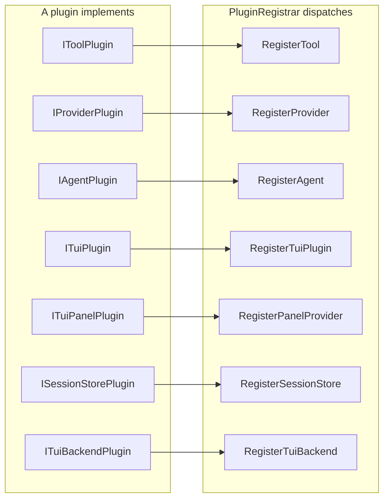

# Seam graph

Generated by [`tools/gen-seam-graph.py`](../tools/gen-seam-graph.py). Do not edit by hand. Regenerate with:

```
./tools/gen-seam-graph.py --write
```

Every row below is read out of the C# sources at the moment of generation. Nothing here is a hand-maintained claim, which is the point: the graph cannot drift away from the code, and the CI job `seamgraph` fails the build when it does.

The graph answers four questions about a seam: **who implements it**, **who extends what implements it**, **who consumes it**, and **who is registered in the container**. It also reports the question nobody asks, which is the one that finds bugs: **where the seam is bypassed**, the places that name the concrete type where the interface was the contract.

## 1. Extension axes

The axes of plugin extension, read out of [`src/Harbor.Plugins.Abstractions/PluginAxisRegistry.cs`](../src/Harbor.Plugins.Abstractions/PluginAxisRegistry.cs), the single registry the architecture rule `ExtensionAxisRegistrationRule` grades the code against. Each axis has two halves: a **marker** a plugin implements, and a **door** on [`src/Harbor.Plugins.Abstractions/IPluginLoadHost.cs`](../src/Harbor.Plugins.Abstractions/IPluginLoadHost.cs) that receives the contribution.

**In-tree implementers** are the classes under `src/` and `apps/` that implement the marker. **Out-of-tree implementers** are the ones under `tests/` and `samples/`, the doubles and the sample plugins.

| Axis | Marker | Door | In-tree implementers | Out-of-tree implementers | Marker dispatched at | Door called at |
|---|---|---|---|---|---|---|
| IToolPlugin | `IToolPlugin` | `RegisterTool` | none | `HelloWorldPlugin`, `SessionBroadcastPlugin`, `FileTreePlugin`, `GitToolsPlugin`, `TodoWritePlugin`, `WebSearchPlugin` (+11 more) | src/Harbor.Plugins.Registration/PluginAxisMarkers.cs:88 | src/Harbor.Plugins.Hosting/PluginInventoryLoadHost.cs:84, src/Harbor.Plugins.Registration/PluginRegistrar.cs:398 (+1 more) |
| IProviderPlugin | `IProviderPlugin` | `RegisterProvider` | none | none | src/Harbor.Plugins.Registration/PluginAxisMarkers.cs:89 | src/Harbor.Plugins.Hosting/PluginInventoryLoadHost.cs:88, src/Harbor.Plugins.Registration/PluginRegistrar.cs:439 (+3 more) |
| IAgentPlugin | `IAgentPlugin` | `RegisterAgent` | none | none | src/Harbor.Plugins.Registration/PluginAxisMarkers.cs:90 | src/Harbor.Plugins.Hosting/PluginInventoryLoadHost.cs:92, src/Harbor.Plugins.Registration/PluginRegistrar.cs:487 (+1 more) |
| ITuiPlugin | `ITuiPlugin` | `RegisterTuiPlugin` | none | `ProbeTuiPlugin` | src/Harbor.Plugins.Registration/PluginAxisMarkers.cs:91 | src/Harbor.Plugins.Hosting/PluginInventoryLoadHost.cs:96, src/Harbor.Plugins.Registration/PluginRegistrar.cs:161 (+1 more) |
| ITuiPanelPlugin | `ITuiPanelPlugin` | `RegisterPanelProvider` | none | none | src/Harbor.Plugins.Registration/PluginAxisMarkers.cs:92 | src/Harbor.Plugins.Hosting/PluginInventoryLoadHost.cs:100, src/Harbor.Plugins.Registration/PanelRegistryPluginAdapter.cs:41 (+1 more) |
| ISessionStorePlugin | `ISessionStorePlugin` | `RegisterSessionStore` | none | none | src/Harbor.Plugins.Registration/PluginAxisMarkers.cs:94 | src/Harbor.Plugins.Hosting/PluginInventoryLoadHost.cs:104, src/Harbor.Plugins.Registration/PluginRegistrar.cs:333 (+1 more) |
| ITuiBackendPlugin | `ITuiBackendPlugin` | `RegisterTuiBackend` | none | none | src/Harbor.Plugins.Registration/PluginAxisMarkers.cs:96 | src/Harbor.Plugins.Hosting/PluginInventoryLoadHost.cs:108, src/Harbor.Plugins.Registration/PluginRegistrar.cs:352 (+1 more) |

Two facts a reader would otherwise have to dig for. First, **no in-tree class implements any axis marker**. The markers are extension points, so the only implementers are out-of-tree plugins, the samples and the test doubles. Second, **every door is called on a receiver** inside the product, which is the half the architecture rule grades.

### 1.1 Which route carries which axis

A **route** is the place a plugin's contribution lands: an implementation of `IPluginLoadHost` the product declares a route for. What the route does with each axis is DECLARED in [`src/Harbor.Plugins.Hosting/PluginRouteAxisRegistry.cs`](../src/Harbor.Plugins.Hosting/PluginRouteAxisRegistry.cs) since #1723, and the table reads that file for the verdict and the reason.

The **observed** column is the other half: what the route's own door body does, read from the source. The two columns are printed side by side because the difference between them is the defect the architecture rule grades, and a reader of the graph is here to see it.

| Route | Axis | Door | Declared | Observed | Reason |
|---|---|---|---|---|---|
| `mcp-stdio` | `IToolPlugin` | `RegisterTool` | carried | registers | the tool's name, description and input schema travel on tools/list and its result on tools/call, so the core can call it; the tool's own safety profile stays with the host that executes it |
| `mcp-stdio` | `IProviderPlugin` | `RegisterProvider` | refused | refuses | an ILlmClient is a live streaming client: the wire would have to carry per-turn token deltas and the provider's credentials, and the MCP tool protocol carries neither |
| `mcp-stdio` | `IAgentPlugin` | `RegisterAgent` | refused | refuses | the core evaluates the agent's PermissionRuleset per call and freezes its agent registry at startup, before the lazily spawned plugin host is asked anything; carrying an agent needs a startup handshake this route deliberately does not have |
| `mcp-stdio` | `ITuiPlugin` | `RegisterTuiPlugin` | closed seam | refuses | the seam is closed by owner decision (#564): the plugin's TUI views are collected and never rendered, in-process or out-of-process |
| `mcp-stdio` | `ITuiPanelPlugin` | `RegisterPanelProvider` | refused | refuses | a panel is live UI-process state — it builds a view object and handles keys — so it is not a registration that can be serialized across a process boundary; carrying it needs a panel protocol, which the plugin showcase (#1434) is the place to design |
| `mcp-stdio` | `ISessionStorePlugin` | `RegisterSessionStore` | refused | refuses | the store is resolved in the core at startup through HARBOR_STORAGE; a store behind the pipe would put every session read and write on IPC, and the core's store contract has no remote form |
| `mcp-stdio` | `ITuiBackendPlugin` | `RegisterTuiBackend` | refused | refuses | a renderer is constructed in the UI process and paints frames; a backend factory cannot be expressed as an MCP tool, so the renderer axis has no wire form |

- `mcp-stdio` carries 1 of the 7 axes, refuses 5 and closes 1.

The other implementations of `IPluginLoadHost` in the product are not routes: the registry does not name them, and the graph does not pretend otherwise. They are still answers to the same doors, so a reader looking for who answers a given door has to see them.

| Implementation | What its doors do | Where |
|---|---|---|
| `PluginInventoryLoadHost` | delegates | [`src/Harbor.Plugins.Hosting/PluginInventoryLoadHost.cs`](../src/Harbor.Plugins.Hosting/PluginInventoryLoadHost.cs) (the door forwards the contribution to another host) |
| `RecordingPluginLoadHost` | delegates | [`src/Harbor.Plugins.Registration/RecordingPluginLoadHost.cs`](../src/Harbor.Plugins.Registration/RecordingPluginLoadHost.cs) (the door forwards the contribution to another host) |

### 1.2 The axes as a graph



## 2. Core seams

Every interface declared under `src/`, ranked by how much of the product touches it. **Implementations** counts the classes that implement it, directly or through a base class; the in-tree ones come first and the out-of-tree ones (doubles, samples) after a `/`. **Consumers** counts the files that name it, excluding the files that only put it in a base list. **Registered** is the container registration, if the seam is resolved from the DI graph. **Bypasses** counts the places that name the concrete type where the interface was the contract.

The table shows the 40 seams with the most in-tree implementations and consumers, out of 195 interfaces declared under `src/`. The rest are in `--report`.

| Seam | Declared in | Implementations | Consumer files | Registered as | Bypasses |
|---|---|---|---|---|---|
| `ISessionStore` | [`src/Harbor.Abstractions/Sessions/ISessionStore.cs`](../src/Harbor.Abstractions/Sessions/ISessionStore.cs) | `JsonlSessionStore`, `MemorySessionStore`, `SqliteSessionStore`, `DeferredSessionStore` / `StoreDouble`, `TestSessionStore`, `ControllableStore` (+15 more) | 82 | a factory | 9 |
| `ITool` | [`src/Harbor.Abstractions/Tools/ITool.cs`](../src/Harbor.Abstractions/Tools/ITool.cs) | `SandboxedPluginTool`, `TelemetryToolDecorator`, `BashTool`, `EditTool`, `GlobTool` (+21 more) / `HelloTool (plugins-cs)`, `SessionBroadcastTool`, `SessionInboxTool` (+40 more) | 55 | none | 30 |
| `IProviderRegistry` | [`src/Harbor.Abstractions/Providers/IProviderRegistry.cs`](../src/Harbor.Abstractions/Providers/IProviderRegistry.cs) | `ProviderRegistry (Harbor.Registries)`, `InstrumentedProviderRegistry` / `EmptyProviderRegistry`, `PricedModelRegistry`, `FakeRegistry (Harbor.App.Avalonia.Tests)` (+10 more) | 63 | a factory | 6 |
| `IEventBus` | [`src/Harbor.Abstractions/Events/IEventBus.cs`](../src/Harbor.Abstractions/Events/IEventBus.cs) | `NullEventBus`, `InMemoryEventBus` / `CancelHonoringBus`, `CancelOnTurnStartBus`, `ThrowingUpdateBus` (+3 more) | 62 | none | 3 |
| `ILlmClient` | [`src/Harbor.Abstractions/Providers/ILlmClient.cs`](../src/Harbor.Abstractions/Providers/ILlmClient.cs) | `RecordedSessionLlmClient`, `RetryLlmClientDecorator`, `AnthropicLlmClient`, `OllamaLlmClient`, `OpenAILlmClient` (+2 more) / `FakeClient (Harbor.App.Avalonia.Tests)`, `HangingLlmClient (Harbor.Application.Tests)`, `TokenCapturingLlmClient` (+12 more) | 53 | none | 7 |
| `IAgentRegistry` | [`src/Harbor.Abstractions/Agents/AgentDefinition.cs`](../src/Harbor.Abstractions/Agents/AgentDefinition.cs) | `AgentRegistry` / `FakeAgentRegistry (Harbor.App.Avalonia.Tests)`, `FixedRegistry`, `FixedOrderAgentRegistry` (+3 more) | 51 | a factory | 4 |
| `IAgent` | [`src/Harbor.Abstractions/Agents/IAgent.cs`](../src/Harbor.Abstractions/Agents/IAgent.cs) | `DefaultAgent`, `TracingAgentProxy` / `FakeAgent (Harbor.App.Avalonia.Tests)`, `FakeAgent (Harbor.App.Cli.Tests)`, `ScriptedAgent` (+5 more) | 45 | a factory | 1 |
| `IToolRegistry` | [`src/Harbor.Abstractions/Tools/IToolRegistry.cs`](../src/Harbor.Abstractions/Tools/IToolRegistry.cs) | `CompositeToolRegistry`, `ToolRegistry`, `InstrumentedToolRegistry` / `CountingRegistry`, `StableToolRegistry`, `BenchToolRegistry` (+2 more) | 40 | a factory | 5 |
| `IConfigStore` | [`src/Harbor.PolicyConfig/Configuration/ConfigStore.cs`](../src/Harbor.PolicyConfig/Configuration/ConfigStore.cs) | `JsonConfigStore` / `InMemoryConfigStore`, `StubConfigStore (Harbor.App.Cli.Tests)`, `RecordingConfigStore` (+4 more) | 38 | a factory | 2 |
| `ITuiRenderer` | [`src/Harbor.Terminal.Abstractions/ITuiRenderer.cs`](../src/Harbor.Terminal.Abstractions/ITuiRenderer.cs) | `BaseTuiRenderer`, `IInteractiveTuiRenderer` / `ScriptedInputRenderer`, `ScriptedRenderer`, `CapturingRenderer` (+5 more) | 34 | a factory | 0 |
| `ISessionContext` | [`src/Harbor.Abstractions/Sessions/ISessionStore.cs`](../src/Harbor.Abstractions/Sessions/ISessionStore.cs) | `DummySessionContext`, `DefaultSessionContext` / `LoopSessionContext`, `CancelOnFirstAppendContext`, `TestSessionContext (Harbor.Application.Tests)` (+6 more) | 32 | none | 2 |
| `ITuiRenderContext` | [`src/Harbor.Terminal.Abstractions/Renderers/ITuiRenderContext.cs`](../src/Harbor.Terminal.Abstractions/Renderers/ITuiRenderContext.cs) | `CaptureRenderContext`, `AnsiPlainRenderContext`, `CellForgeRenderContext`, `NotificationRenderContext` / `NullRenderContext` | 28 | none | 4 |
| `ITokenTracker` | [`src/Harbor.Abstractions/Sessions/ITokenTracker.cs`](../src/Harbor.Abstractions/Sessions/ITokenTracker.cs) | `TokenTracker` / `FakeTokenTracker (Harbor.App.Cli.Tests)`, `FakeTokenTracker (Harbor.Application.Tests)`, `RecordingTokenTracker` (+2 more) | 26 | `TokenTracker` | 0 |
| `IApprovalCoordinator` | [`src/Harbor.Abstractions/Permissions/IApprovalCoordinator.cs`](../src/Harbor.Abstractions/Permissions/IApprovalCoordinator.cs) | `ApprovalCoordinator` | 25 | a factory | 1 |
| `IToolRegistryBuilder` | [`src/Harbor.Abstractions/Tools/IToolRegistry.cs`](../src/Harbor.Abstractions/Tools/IToolRegistry.cs) | `ToolRegistryBuilderAdapter`, `ToolRegistryBuilder` | 22 | none | 2 |
| `IPermissionService` | [`src/Harbor.Abstractions.Contracts/Permissions/PermissionRuleset.cs`](../src/Harbor.Abstractions.Contracts/Permissions/PermissionRuleset.cs) | `PermissionService` / `FixedVerdictPermissions`, `GatedPermissions`, `BenchPermissionService` | 22 | a factory, a factory (+2 more) | 5 |
| `IPluginLoadHost` | [`src/Harbor.Plugins.Abstractions/IPluginLoadHost.cs`](../src/Harbor.Plugins.Abstractions/IPluginLoadHost.cs) | `McpPluginLoadHost`, `PluginInventoryLoadHost`, `RecordingPluginLoadHost` / `FakePluginLoadHost (CsPluginLoaderTests.cs)`, `FakePluginLoadHost (FakePluginLoadHost.cs)`, `RefusingPluginLoadHost` | 20 | none | 6 |
| `IArgSafetyPolicy` | [`src/Harbor.Abstractions.Contracts/Permissions/IArgSafetyPolicy.cs`](../src/Harbor.Abstractions.Contracts/Permissions/IArgSafetyPolicy.cs) | `BashSafetyPolicy`, `PathGuardSafetyPolicy` / `DenyMyToolPolicy` | 20 | none | 4 |
| `IPanelProvider` | [`src/Harbor.Ui.Framework.State/Panels/IPanelProvider.cs`](../src/Harbor.Ui.Framework.State/Panels/IPanelProvider.cs) | `CellForgeJumpPalettePanel`, `CellForgePanelBase`, `CellForgeSkillFreshnessPanel`, `CellForgeSubagentsPanel` / `GitStatusPanel`, `TodoListPanel`, `ContainerFieldPanel` (+5 more) | 18 | none | 4 |
| `IToastService` | [`src/Harbor.Ui.Framework.Services/Services/IToastService.cs`](../src/Harbor.Ui.Framework.Services/Services/IToastService.cs) | `ToastService` / `FakeToastService`, `StubToastService`, `SilentToastService` | 21 | a factory | 0 |
| `IPlugin` | [`src/Harbor.Abstractions/Plugins/IPlugin.cs`](../src/Harbor.Abstractions/Plugins/IPlugin.cs) | `IToolPlugin`, `IProviderPlugin`, `IAgentPlugin`, `ISessionStorePlugin`, `ITuiBackendPlugin` (+1 more) / `ITelemetryPlugin`, `StubPlugin`, `FakePlugin` (+2 more) | 15 | none | 0 |
| `IProviderHealthCheck` | [`src/Harbor.Abstractions/Providers/IProviderHealthCheck.cs`](../src/Harbor.Abstractions/Providers/IProviderHealthCheck.cs) | `ProviderHealthCheck` / `FakeHealthCheck`, `StubHealthCheck` | 19 | none | 0 |
| `IChatBlock` | [`src/Harbor.Ui.Framework.Rendering/Widgets/ChatBlock.cs`](../src/Harbor.Ui.Framework.Rendering/Widgets/ChatBlock.cs) | `ColumnsBlock`, `ImageBlock`, `StreamingMarkdownBlock`, `ApprovalGateView`, `ICollapsibleChatBlock` (+5 more) / `WidthBlock`, `FixedBlock`, `StoreBlock` (+3 more) | 9 | none | 20 |
| `IDispatcherAdapter` | [`src/Harbor.Ui.Framework.Services/Services/IDispatcherAdapter.cs`](../src/Harbor.Ui.Framework.Services/Services/IDispatcherAdapter.cs) | `AvaloniaDispatcherAdapter` / `TestDispatcherAdapter` | 18 | `AvaloniaDispatcherAdapter` | 0 |
| `IMcpRegistry` | [`src/Harbor.Abstractions/Tools/IMcpRegistry.cs`](../src/Harbor.Abstractions/Tools/IMcpRegistry.cs) | `InMemoryMcpRegistry`, `McpRegistry` / `ScriptedMcpRegistry` | 17 | a factory | 3 |
| `IPanelRegistry` | [`src/Harbor.Ui.Framework.State/Panels/IPanelRegistry.cs`](../src/Harbor.Ui.Framework.State/Panels/IPanelRegistry.cs) | `PanelRegistryPluginAdapter`, `PanelRegistry` | 17 | a factory | 12 |
| `IRendererPipeline` | [`src/Harbor.Hosting/Rendering/IRendererPipeline.cs`](../src/Harbor.Hosting/Rendering/IRendererPipeline.cs) | `RendererPipeline` | 18 | a factory | 1 |
| `ICommonConfigStore` | [`src/Harbor.Desktop.Abstractions/Configuration/ICommonConfigStore.cs`](../src/Harbor.Desktop.Abstractions/Configuration/ICommonConfigStore.cs) | `JsonCommonConfigStore` / `StubCommonConfigStore`, `TokenWatchingConfigStore`, `RecordingCommonStore` (+2 more) | 17 | a factory, a factory | 4 |
| `IAuthResolver` | [`src/Harbor.Abstractions/Providers/IAuthResolver.cs`](../src/Harbor.Abstractions/Providers/IAuthResolver.cs) | `CommonConfigAuthResolver`, `ConfigAuthResolver`, `EnvVarAuthResolver` / `StubAuthResolver (Harbor.App.Avalonia.Tests)`, `EnvOnlyAuthResolver`, `NoKeysAnywhereAuthResolver` (+5 more) | 14 | a factory | 5 |
| `ICollapsibleChatBlock` | [`src/Harbor.Ui.Framework.Rendering/Widgets/ChatBlock.cs`](../src/Harbor.Ui.Framework.Rendering/Widgets/ChatBlock.cs) | `AssistantMarkdownBlock`, `ReadGroupBlock`, `TableBlock`, `StreamingThinkingBlock`, `ThinkingBlock` (+4 more) | 7 | none | 21 |
| `IRequestHandler` | [`src/Harbor.Ipc.Server/Protocol/IRequestHandler.cs`](../src/Harbor.Ipc.Server/Protocol/IRequestHandler.cs) | `StartAgentRequestHandler`, `AbortAgentRequestHandler`, `SendPromptRequestHandler`, `CreateSessionRequestHandler`, `ListSessionsRequestHandler` (+9 more) | 2 | none | 14 |
| `ISessionManager` | [`src/Harbor.Ui.Framework.Sessions/Sessions/ISessionManager.cs`](../src/Harbor.Ui.Framework.Sessions/Sessions/ISessionManager.cs) | `SessionManager` / `FakeSessionManager (Harbor.App.Avalonia.Tests)`, `NoSessionsManager`, `StubSessionManager` (+1 more) | 15 | a factory | 0 |
| `IShellChrome` | [`src/Harbor.Ui.Framework.Abstractions/Navigation/IShellChrome.cs`](../src/Harbor.Ui.Framework.Abstractions/Navigation/IShellChrome.cs) | `AvaloniaShellChrome` | 15 | `AvaloniaShellChrome` | 0 |
| `IGitQuery` | [`src/Harbor.Abstractions/Git/IGitQuery.cs`](../src/Harbor.Abstractions/Git/IGitQuery.cs) | `ProcessGitQuery` / `TestGitQuery`, `ThrowingGitQuery (Harbor.TestKit.Support)`, `StubGitQuery` (+1 more) | 14 | `ProcessGitQuery`, `ProcessGitQuery` | 0 |
| `IFocusTarget (Harbor.Tui.CellForge.Engine)` | [`src/Harbor.Tui.CellForge.Engine/Input/IFocusTarget.cs`](../src/Harbor.Tui.CellForge.Engine/Input/IFocusTarget.cs) | `IFocusable` | 13 | none | 0 |
| `IFocusTarget (Harbor.Ui.Framework.Rendering)` | [`src/Harbor.Ui.Framework.Rendering/Input/IFocusTarget.cs`](../src/Harbor.Ui.Framework.Rendering/Input/IFocusTarget.cs) | `IFocusable` | 13 | none | 0 |
| `ITuiRendererFactory` | [`src/Harbor.Hosting/Modules/TuiBackendRegistry.cs`](../src/Harbor.Hosting/Modules/TuiBackendRegistry.cs) | `PlainTuiRendererFactory`, `AnsiTuiRendererFactory`, `CellForgeTuiRendererFactory`, `PluginTuiRendererFactory`, `SpectreTuiRendererFactory` (+5 more) | 4 | none | 10 |
| `IHarborClient` | [`src/Harbor.Ipc.Abstractions/IHarborClient.cs`](../src/Harbor.Ipc.Abstractions/IHarborClient.cs) | `IpcHarborClient`, `InProcessHarborClient` / `FakeHarborClient`, `StubHarborClient` | 11 | a factory, `InProcessHarborClient` | 1 |
| `IPluginSource` | [`src/Harbor.Plugins.Abstractions/IPluginSource.cs`](../src/Harbor.Plugins.Abstractions/IPluginSource.cs) | `CompositePluginSource`, `EmbeddedResourcePluginSource`, `FileSystemPluginSource`, `InMemoryPluginSource`, `TrustingPluginSource` | 8 | none | 5 |
| `IThemeApplier` | [`src/Harbor.Ui.Framework.Services/Services/IThemeApplier.cs`](../src/Harbor.Ui.Framework.Services/Services/IThemeApplier.cs) | none / `StubThemeApplier`, `RecordingThemeApplier` | 13 | a factory | 0 |

## 3. Three seams in detail

The table above is a census. These are the seams a reader most often has to reason about, and the graph says things about them that are not visible by reading one file.

### `IToolRegistry`

Declared in [`src/Harbor.Abstractions/Tools/IToolRegistry.cs`](../src/Harbor.Abstractions/Tools/IToolRegistry.cs).

- **In-tree implementations** (3):
  - `CompositeToolRegistry`, [`src/Harbor.Registries/Tools/CompositeToolRegistry.cs`](../src/Harbor.Registries/Tools/CompositeToolRegistry.cs)
  - `ToolRegistry`, [`src/Harbor.Registries/Tools/ToolRegistry.cs`](../src/Harbor.Registries/Tools/ToolRegistry.cs)
  - `InstrumentedToolRegistry`, [`src/Harbor.Telemetry.Core/InstrumentedToolRegistry.cs`](../src/Harbor.Telemetry.Core/InstrumentedToolRegistry.cs)
- **Out-of-tree implementations** (5):
  - `CountingRegistry`, [`tests/Harbor.Application.Tests/ToolDispatcherResolveOnceTests.cs`](../tests/Harbor.Application.Tests/ToolDispatcherResolveOnceTests.cs)
  - `StableToolRegistry`, [`tests/Harbor.Application.Tests/TurnRunnerToolTableReuseTests.cs`](../tests/Harbor.Application.Tests/TurnRunnerToolTableReuseTests.cs)
  - `BenchToolRegistry`, [`tests/Harbor.Benchmarks/AgentLoopBenchmark.cs`](../tests/Harbor.Benchmarks/AgentLoopBenchmark.cs)
  - `SingleToolRegistry`, [`tests/Harbor.Telemetry.Tests/DecoratorTelemetryTests.cs`](../tests/Harbor.Telemetry.Tests/DecoratorTelemetryTests.cs)
  - `FakeToolRegistry`, [`tests/Harbor.TestKit/Fakes/IToolRegistry.cs`](../tests/Harbor.TestKit/Fakes/IToolRegistry.cs)
- **Named by** 40 file(s) in 17 project(s): Harbor.Abstractions, Harbor.AgentRuntime, Harbor.App.Avalonia, Harbor.App.Avalonia.Tests, Harbor.App.Cli, Harbor.App.Cli.Tests, Harbor.Application.Tests, Harbor.Architecture.Tests, Harbor.Hosting, Harbor.Hosting.Tests
- **Registered in the container**: `IToolRegistry` → a factory (Singleton, [`src/Harbor.Hosting/Modules/RegistryFacade.cs`](../src/Harbor.Hosting/Modules/RegistryFacade.cs))
- **Bypassed**: 2 direct construction(s) of the concrete type, 3 signature(s) naming the concrete type where the interface was the contract:
  - `InstrumentedToolRegistry` instead of `IToolRegistry`, construction at [`src/Harbor.Hosting/Modules/RegistryFacade.cs`](../src/Harbor.Hosting/Modules/RegistryFacade.cs):162
  - `ToolRegistry` instead of `IToolRegistry`, construction at [`src/Harbor.Hosting/Modules/ToolsCatalog.cs`](../src/Harbor.Hosting/Modules/ToolsCatalog.cs):174
  - `ToolRegistry` instead of `IToolRegistry`, signature at [`src/Harbor.Hosting/HarborCompositionContext.cs`](../src/Harbor.Hosting/HarborCompositionContext.cs):188
  - `ToolRegistry` instead of `IToolRegistry`, signature at [`src/Harbor.Hosting/HarborCompositionContext.cs`](../src/Harbor.Hosting/HarborCompositionContext.cs):200
  - `ToolRegistry` instead of `IToolRegistry`, signature at [`src/Harbor.Hosting/Modules/ToolsCatalog.cs`](../src/Harbor.Hosting/Modules/ToolsCatalog.cs):164

### `ILlmClient`

Declared in [`src/Harbor.Abstractions/Providers/ILlmClient.cs`](../src/Harbor.Abstractions/Providers/ILlmClient.cs).

- **In-tree implementations** (7):
  - `RecordedSessionLlmClient`, [`src/Harbor.AgentRuntime/Agents/RecordedSessionLlmClient.cs`](../src/Harbor.AgentRuntime/Agents/RecordedSessionLlmClient.cs)
  - `RetryLlmClientDecorator`, [`src/Harbor.AgentRuntime/Resilience/RetryLlmClientDecorator.cs`](../src/Harbor.AgentRuntime/Resilience/RetryLlmClientDecorator.cs)
  - `AnthropicLlmClient`, [`src/Harbor.Providers.Anthropic/AnthropicLlmClient.cs`](../src/Harbor.Providers.Anthropic/AnthropicLlmClient.cs)
  - `OllamaLlmClient`, [`src/Harbor.Providers.Ollama/OllamaLlmClient.cs`](../src/Harbor.Providers.Ollama/OllamaLlmClient.cs)
  - `OpenAILlmClient`, [`src/Harbor.Providers.OpenAI/OpenAILlmClient.cs`](../src/Harbor.Providers.OpenAI/OpenAILlmClient.cs)
  - `OpenAiCompatibleLlmClient`, [`src/Harbor.Providers.OpenAiCompatible/OpenAiCompatibleLlmClient.cs`](../src/Harbor.Providers.OpenAiCompatible/OpenAiCompatibleLlmClient.cs)
  - `InstrumentedLlmClient`, [`src/Harbor.Telemetry.Core/InstrumentedLlmClient.cs`](../src/Harbor.Telemetry.Core/InstrumentedLlmClient.cs)
- **Out-of-tree implementations** (15):
  - `FakeClient (Harbor.App.Avalonia.Tests)`, [`tests/Harbor.App.Avalonia.Tests/OnboardingViewModelLiveModelsTests.cs`](../tests/Harbor.App.Avalonia.Tests/OnboardingViewModelLiveModelsTests.cs)
  - `HangingLlmClient (Harbor.Application.Tests)`, [`tests/Harbor.Application.Tests/ExecutionTreeTests.cs`](../tests/Harbor.Application.Tests/ExecutionTreeTests.cs)
  - `TokenCapturingLlmClient`, [`tests/Harbor.Application.Tests/RunBudgetTests.cs`](../tests/Harbor.Application.Tests/RunBudgetTests.cs)
  - `ScriptedStreamClient`, [`tests/Harbor.Application.Tests/TurnRunnerUpdateCoalescingTests.cs`](../tests/Harbor.Application.Tests/TurnRunnerUpdateCoalescingTests.cs)
  - `BenchTextLlmClient`, [`tests/Harbor.Benchmarks/AgentLoopBenchmark.cs`](../tests/Harbor.Benchmarks/AgentLoopBenchmark.cs)
  - `BenchToolLlmClient`, [`tests/Harbor.Benchmarks/AgentLoopBenchmark.cs`](../tests/Harbor.Benchmarks/AgentLoopBenchmark.cs)
  - `StubSummarizingLlmClient`, [`tests/Harbor.Benchmarks/CompactionServiceBenchmark.cs`](../tests/Harbor.Benchmarks/CompactionServiceBenchmark.cs)
  - `StubLlmClient (Harbor.Benchmarks)`, [`tests/Harbor.Benchmarks/ProviderRegistryBenchmark.cs`](../tests/Harbor.Benchmarks/ProviderRegistryBenchmark.cs)
  - `FakeCatalogClient`, [`tests/Harbor.Config.Tests/OnboardingWizardTests.cs`](../tests/Harbor.Config.Tests/OnboardingWizardTests.cs)
  - `ScriptedLlmClient (Harbor.Core.Tests)`, [`tests/Harbor.Core.Tests/CompactionSummaryRetryTests.cs`](../tests/Harbor.Core.Tests/CompactionSummaryRetryTests.cs)
  - `CapturingLlmClient`, [`tests/Harbor.Core.Tests/CompactionTestBase.cs`](../tests/Harbor.Core.Tests/CompactionTestBase.cs)
  - `RateLimitedLlmClient`, [`tests/Harbor.LoadTests/LoadTestFakes.cs`](../tests/Harbor.LoadTests/LoadTestFakes.cs)
  - `CatalogSource`, [`tests/Harbor.Registries.Tests/ProviderRegistryCatalogCacheTtlTests.cs`](../tests/Harbor.Registries.Tests/ProviderRegistryCatalogCacheTtlTests.cs)
  - `ScriptedLlmClient (Harbor.TestKit)`, [`tests/Harbor.TestKit/Fakes/ILlmClient.cs`](../tests/Harbor.TestKit/Fakes/ILlmClient.cs)
  - `ThrowingLlmClient`, [`tests/Harbor.TestKit/Fakes/ILlmClient.cs`](../tests/Harbor.TestKit/Fakes/ILlmClient.cs)
- **Named by** 53 file(s) in 24 project(s): Harbor.Abstractions, Harbor.AgentRuntime, Harbor.App.Avalonia.Tests, Harbor.App.Cli.Tests, Harbor.Application.Tests, Harbor.Architecture.Tests, Harbor.Benchmarks, Harbor.Config.Tests, Harbor.Core.Tests, Harbor.Hosting
- **Registered in the container**: **no DI registration**
- **Bypassed**: 7 direct construction(s) of the concrete type, 0 signature(s) naming the concrete type where the interface was the contract:
  - `RetryLlmClientDecorator` instead of `ILlmClient`, construction at [`src/Harbor.AgentRuntime/Resilience/RetryLlmClientDecorator.cs`](../src/Harbor.AgentRuntime/Resilience/RetryLlmClientDecorator.cs):265
  - `OpenAiCompatibleLlmClient` instead of `ILlmClient`, construction at [`src/Harbor.Hosting/Modules/JsonProviderDiscovery.cs`](../src/Harbor.Hosting/Modules/JsonProviderDiscovery.cs):179
  - `OpenAiCompatibleLlmClient` instead of `ILlmClient`, construction at [`src/Harbor.Hosting/Modules/JsonProviderDiscovery.cs`](../src/Harbor.Hosting/Modules/JsonProviderDiscovery.cs):212
  - `OllamaLlmClient` instead of `ILlmClient`, construction at [`src/Harbor.Hosting/Modules/ProviderFactories.cs`](../src/Harbor.Hosting/Modules/ProviderFactories.cs):127
  - `AnthropicLlmClient` instead of `ILlmClient`, construction at [`src/Harbor.Hosting/Modules/ProviderFactories.cs`](../src/Harbor.Hosting/Modules/ProviderFactories.cs):147
  - `OpenAILlmClient` instead of `ILlmClient`, construction at [`src/Harbor.Hosting/Modules/ProviderFactories.cs`](../src/Harbor.Hosting/Modules/ProviderFactories.cs):168
  - `InstrumentedLlmClient` instead of `ILlmClient`, construction at [`src/Harbor.Telemetry.Core/InstrumentedLlmClient.cs`](../src/Harbor.Telemetry.Core/InstrumentedLlmClient.cs):26

### `IPluginHost`

Declared in [`src/Harbor.Abstractions/Plugins/IPlugin.cs`](../src/Harbor.Abstractions/Plugins/IPlugin.cs).

- **In-tree implementations** (0):
  - **none**
- **Out-of-tree implementations** (0):
  - **none**
- **Named by** 1 file(s) in 1 project(s): Harbor.Abstractions
- **Registered in the container**: **no DI registration**
- **Bypassed**: 0 direct construction(s) of the concrete type, 0 signature(s) naming the concrete type where the interface was the contract:
  - **none**

## 4. Holes

What the graph finds that reading the code does not: interfaces with no implementation, seams nobody resolves from the container, and implementations nobody consumes.

- **15 interface(s) declared under `src/` are named somewhere but have no implementation**: `IEventSubscriber`, `IHarborIdeClient`, `IProviderPlugin`, `IAgentPlugin`, `IPluginHost`, `IToolFactory`, `IRetryAfterHint`, `ISessionStorePlugin`, `ITuiBackendPlugin`, `IInteractiveTuiRenderer`, `IBindingScope`, `IInputHandler`, `ICellDiffDecoder`, `IThemeWatcher`, `ITuiPanelPlugin`
- **111 seam(s) with an implementation have no container registration**: `IAgentRegistryBuilder`, `IBackgroundTaskRegistry`, `ISubAgentRunner`, `IEventBus`, `IEventBusMiddleware`, `IEventBusQueueMetrics`, `IProcessHandle`, `ILspService`, `INotificationProcessRunner`, `IPlugin`, `IToolPlugin`, `ILlmClient`, `IProviderFactory`, `IProviderHealthCheck`, `IProviderRegistryBuilder`, `ICompactionEventStore`, `ITokenEstimator`, `ISessionCheckpointStore`, `ISessionFeedbackStore`, `ISessionQuery` …
  That is a census of the `AddSingleton<T>` calls, not a verdict on reachability: a seam can also be resolved through a registry rather than the container. `ILlmClient` is reached through `IProviderRegistry`, not through DI.
- No door of a declared route answers `Result.Success` without registering anything (the #1758 shape).
- Every declared route verdict agrees with what the route's door body does.

## 5. What this graph does not see

A graph that hides its own blind spots is a decoration. These are the gaps, and they are gaps of a TEXT SCAN, not of the code:

- **DI registrations written without a type argument** (`services.AddSingleton(sp => new Foo())`) are invisible: the service type is inferred by the compiler, and the scan has no compiler.
- **Bypasses in a signature** are a heuristic: a type name followed by a member name is matched by shape, not by a parsed type. The count is an upper bound.
- **`contrib/` is not scanned.** It is not compiled by CI and the owner marked it unmaintained, so a seam that only exists there is not a seam of this product.
- **Extension methods are not classified.** A static class with `this` in its first parameter is a seam to read, and the scan does not say so.
- **Reflection-reached seams are not counted as consumed.** A type resolved by name at run time has no textual mention to find.
- **A simple name that two namespaces share is disambiguated in the labels, but the EDGES are resolved per namespace.** An ambiguous name used in a base list resolves to nothing rather than to a guess.
- **The route registry pairs a route with its host by NAME.** The registry declares `McpStdioRouteId` and `McpStdioHostType` as two constants, and the graph pairs them because the names share a prefix. A route whose id and host type do not share one is read as a route with no host, and the table says so.
- **The type graph is one level of inheritance deep for the `extends` edges, and closed transitively for the `implements` edges.** A base class reached only through an alias is not seen.

## 6. How to regenerate and to check

```
./tools/gen-seam-graph.py --write     # regenerate this file
./tools/gen-seam-graph.py --check     # fail if this file is stale
./tools/gen-seam-graph.py --report    # the numbers, on stdout
./tools/gen-seam-graph.py --self-test # prove the checker can fail
```
